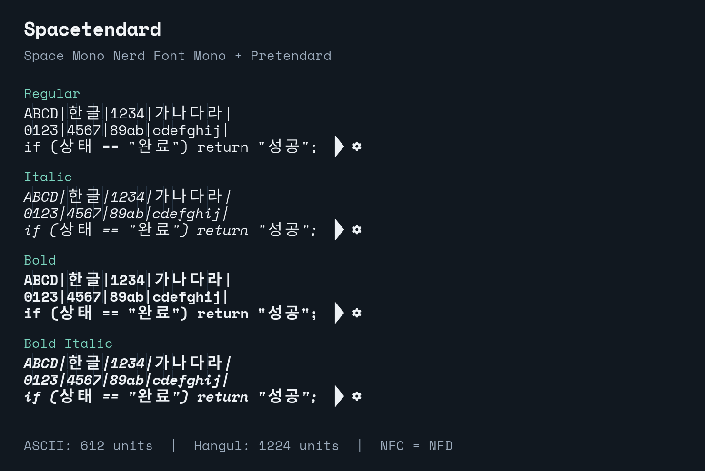

# Spacetendard

[한국어](README.md) · [Downloads](https://github.com/IamGroooooot/spacetendard/releases/latest) · [Acknowledgements](NOTICE.md) · [Licenses](LICENSES.md)

**Space Mono Nerd Font Mono + Pretendard. One cell for Latin, two for Hangul.**

Spacetendard was inspired by [Jetendard](https://github.com/kuskhan/jetendard)
and follows the same approach. It forks and modifies Jetendard's actual build
code, replacing JetBrains Mono with Space Mono Nerd Font Mono and fitting
Pretendard's Korean glyphs to the grid.

I made this to keep ASCII sequence diagrams and text UML aligned when they
include Korean.



## Credits and thanks

Thank you to **Jetendard** for publishing the code that made this customization
possible; to **Space Mono** for the Latin typeface; to **Nerd Fonts** for its
Space Mono Nerd Font Mono distribution and developer icons; and to
**Pretendard** for its Korean glyphs. Spacetendard builds on their work.

| Project | Contribution | Original source |
| --- | --- | --- |
| Jetendard — kuskhan / Jung Woong Park | Build, merge, fitting, CLI, and test code | [Repository](https://github.com/kuskhan/jetendard) |
| Space Mono — Google / Colophon Foundry | Latin typeface | [Repository](https://github.com/googlefonts/spacemono) |
| Nerd Fonts — Ryan L McIntyre and contributors | Space Mono Nerd Font Mono and icon patching | [SpaceMono](https://github.com/ryanoasis/nerd-fonts/tree/v3.4.0/patched-fonts/SpaceMono) |
| Pretendard — Kil Hyung-jin | Korean glyphs | [Repository](https://github.com/orioncactus/pretendard) |

Thanks also to [Yeomil Mono](https://github.com/taevel02/yeomil-mono), whose
implementation informed Jetendard, and the individual icon authors.
[NOTICE.md](NOTICE.md) records the full attribution and modifications.

## Download

For installation, use [Spacetendard-0.1.2-ttf.zip](https://github.com/IamGroooooot/spacetendard/releases/download/v0.1.2/Spacetendard-0.1.2-ttf.zip).
The GitHub source-code ZIP does not contain installable fonts.
[All releases and assets](https://github.com/IamGroooooot/spacetendard/releases/latest)
also include OTF, WOFF2/CSS, and checksums. OTF files use TrueType outlines.

Run in an empty working directory on macOS or Linux:

```sh
mkdir -p spacetendard-download
cd spacetendard-download
VERSION=0.1.2
BASE_URL="https://github.com/IamGroooooot/spacetendard/releases/download/v${VERSION}"
curl -fLO "$BASE_URL/Spacetendard-${VERSION}-ttf.zip"
curl -fLO "$BASE_URL/SHA256SUMS.txt"
unzip "Spacetendard-${VERSION}-ttf.zip"
```

Compare the TTF ZIP's checksum with its entry in `SHA256SUMS.txt`:

```sh
# macOS
shasum -a 256 "Spacetendard-${VERSION}-ttf.zip"
# Linux
sha256sum "Spacetendard-${VERSION}-ttf.zip"
```

## Install and select the font

Run from the directory containing the extracted `Spacetendard` folder.
Install all four styles: Regular, Italic, Bold, and BoldItalic.

```sh
# macOS — current user
mkdir -p "$HOME/Library/Fonts/Spacetendard"
cp Spacetendard/*.ttf "$HOME/Library/Fonts/Spacetendard/"
```

```sh
# Linux — current user, with fontconfig installed
mkdir -p "$HOME/.local/share/fonts/Spacetendard"
cp Spacetendard/*.ttf "$HOME/.local/share/fonts/Spacetendard/"
fc-cache -f "$HOME/.local/share/fonts/Spacetendard"
fc-match Spacetendard
```

On Windows, use PowerShell:

```powershell
$version = '0.1.2'
$url = "https://github.com/IamGroooooot/spacetendard/releases/download/v$version/Spacetendard-$version-ttf.zip"
Invoke-WebRequest -Uri $url -OutFile "Spacetendard-$version-ttf.zip"
Expand-Archive -Path "Spacetendard-$version-ttf.zip" -DestinationPath 'spacetendard-download'
explorer.exe '.\spacetendard-download\Spacetendard'
```

Select the four `.ttf` files in Explorer, right-click, and choose **Install**.
Restart your editor or terminal, then select the family **`Spacetendard`**.

For VS Code, merge these entries into User Settings (JSON):

```jsonc
{
  "editor.fontFamily": "'Spacetendard', monospace",
  "terminal.integrated.fontFamily": "Spacetendard"
}
```

See [VS Code's font settings](https://code.visualstudio.com/docs/terminal/appearance).
For [Ghostty](https://ghostty.org/docs/config/reference#font-family), set:

```ini
font-family = Spacetendard
```

If the Ghostty CLI is on PATH, list available fonts with `ghostty +list-fonts`.

For the web, extract the webfont ZIP and serve its entire `Spacetendard` folder
at `/fonts/Spacetendard/`, including the license directory and notices:

```html
<link rel="stylesheet" href="/fonts/Spacetendard/spacetendard.css">
<style>
  pre, code { font-family: 'Spacetendard', monospace; }
</style>
```

## Build and customize

Install [uv](https://docs.astral.sh/uv/getting-started/installation/), then:

```sh
git clone https://github.com/IamGroooooot/spacetendard.git
cd spacetendard
uv sync --locked --all-groups
make download
make run
```

Requires Python 3.12+. Sources are pinned to Nerd Fonts **v3.4.0 / SpaceMono.zip**
and Pretendard **v1.3.9**, with SHA-256 verification. Outputs go to `fonts/ttf`,
`fonts/otf`, and `fonts/webfont`, each with accompanying licenses. Downloads and
default generated output directories are ignored by git.

```sh
uv run spacetendard --help
uv run spacetendard --variants Regular Bold
uv run spacetendard --korean-scale 1.10 --output-dir fonts/custom
uv run spacetendard --family-name "My Hangul Mono" --output-dir fonts/custom-named
uv run spacetendard --weights Regular Bold --styles normal italic
make lint
SPACETENDARD_RUN_FULL_INTEGRATION=1 uv run pytest
```

The default Korean outline scale is `1.15`. Changing it preserves the cell
advance; oversized outlines are capped to fit. Use a separate output directory
for comparisons. Replace the example custom family name with your own unique
name, preserve notices, and document your changes. Other source fonts require
their own license review.

Implementation entry points: `src/spacetendard/builder.py` for fitting and
metrics, `src/spacetendard/cli.py` for CLI and outputs, and `download_upstream.py`
for source versions and checksums.

## Coverage and limits

ASCII and Nerd Font Mono icons occupy one cell (612 units); all 11,172 modern
Hangul syllables occupy two (1,224 units). Modern NFD Jamo sequences shape to
the same glyphs and advances as NFC through HarfBuzz. Compatibility Jamo and
supported fullwidth forms occupy two cells; supported halfwidth forms occupy
one. Korean remains upright in italic styles.

Tests verify every modern syllable and its NFD form across the four generated
TTFs, mixed strings, halfwidth/fullwidth forms, icons, names, style metadata,
and notices. Run `make run` first to include generated-family checks.

This does not guarantee alignment for every Unicode character or renderer.
Unsupported characters, emoji, archaic Hangul, fallback fonts, `wcwidth`,
ambiguous-width settings, and shaping support can affect the result. GitHub's
code blocks use the reader's font, not Spacetendard. Space Mono's Latin outlines,
OpenType features, and Nerd Font icons are retained, except default ASCII arrow
ligatures that collapse two cells into one. `->`, `<-`, and `|>` remain literal
ASCII; actual Unicode arrows keep their one-cell glyphs. JetBrains Mono's programming
ligature set is not added.

## License and redistribution

Spacetendard fonts and derived build software are distributed under **SIL OFL
1.1**, with original icon/component notices and terms retained. Preserve all
copyrights, `LICENSE`, the `licenses` directory, attribution, and modification
notices when redistributing. Modified fonts must remain OFL. Do not use the
upstream Reserved Font Names `Jetendard`, `Pretendard`, or `Yeomil Mono` as a
derivative's font name without the relevant permission.

OFL fonts may not be sold by themselves. Documents, diagrams, and artwork made
with the font do not inherit its license. No upstream endorsement, warranty,
or trademark permission is claimed. The original license texts govern warranty
and liability; this summary adds no restrictions.

See [LICENSE](LICENSE), [NOTICE.md](NOTICE.md), [LICENSES.md](LICENSES.md), and
[original component notices](src/spacetendard/licenses).
