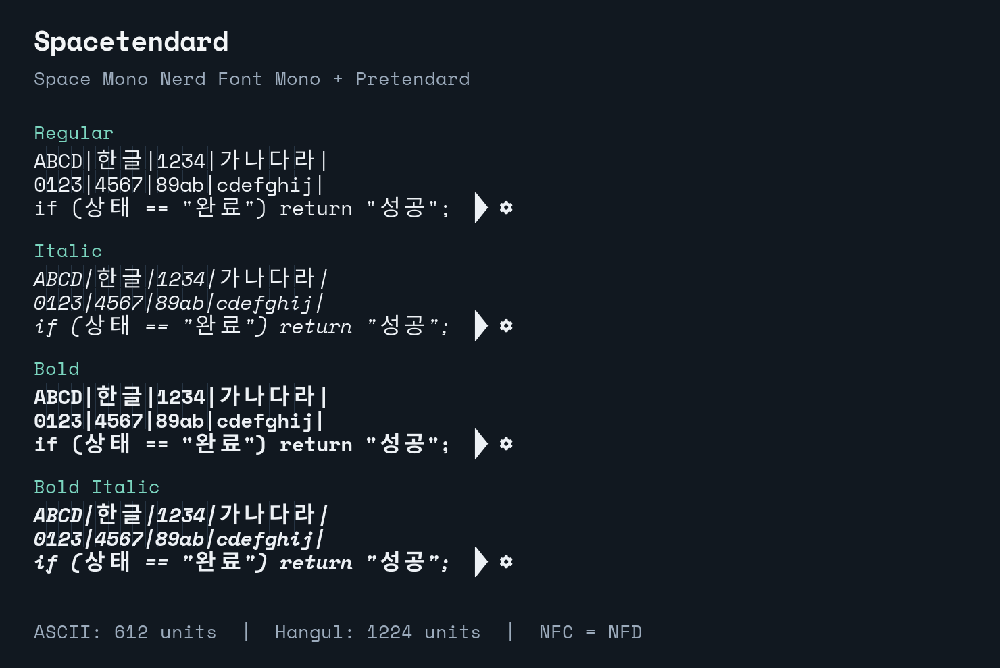

# Spacetendard

**Space Mono Nerd Font Mono와 Pretendard를 결합해 한글을 영문 2칸에 맞춘 폰트입니다.**
[kuskhan/jetendard](https://github.com/kuskhan/jetendard)를 포크하여
JetBrains Mono 대신 Space Mono를 사용합니다. 원본이 참고한
[Yeomil Mono](https://github.com/taevel02/yeomil-mono)의 기여도 함께 밝힙니다.

## 설치

[최신 릴리스](https://github.com/IamGroooooot/spacetendard/releases/latest)에서
TTF 압축 파일을 내려받아 풀고, 네 개의 `.ttf` 파일을 설치하세요.
에디터·터미널의 글꼴을 `Spacetendard`로 선택하고 필요한 경우 앱을 재시작하세요.



## 폭 처리

- 영문·숫자·Nerd Font Mono 아이콘: 1칸, 612 units.
- 현대 한글 완성형 11,172자: 2칸, 1,224 units.
- 분해 자모 한글: HarfBuzz 같은 조판 엔진에서 완성형과 같은 글리프·폭으로 조합.
- 호환 자모와 지원하는 전각 문자: 2칸.
- 지원하는 반각 문자·반각 한글: 1칸.

Regular, Italic, Bold, BoldItalic 네 가지를 제공합니다.
Italic에서도 한글은 기울이지 않습니다. 한글 윤곽은 기본 1.15배로 확대하고
셀 안에 가운데 정렬하며, 넘치는 글리프는 크기를 제한합니다.
Space Mono의 영문·OpenType 기능·Nerd Font 아이콘을 유지합니다.
JetBrains Mono의 프로그래밍 합자 세트를 추가하지는 않습니다.

한글 한 글자가 영문 두 글자 폭을 차지하는 방식입니다.
모든 유니코드 문자를 추가하는 폰트는 아니므로, 지원하지 않는 한자·가나·이모지나
옛한글은 대체 폰트 또는 별도 조판이 필요합니다. 터미널의 문자 폭 판단,
모호한 폭 설정, 대체 폰트, 한글 조합 지원 여부에 따른 차이까지 폰트만으로
해결하지는 못합니다.

## 직접 빌드

```sh
uv sync --all-groups
make download
make run
make lint
make test
```

Nerd Fonts v3.4.0과 Pretendard v1.3.9를 고정하고 다운로드 SHA-256을 검사합니다.
결과는 `fonts/ttf`, `fonts/otf`, `fonts/webfont`에 생성되며,
각 폴더에 저작권·라이선스 고지를 함께 복사합니다.
OTF 확장자 파일도 TrueType 윤곽을 사용합니다.

```sh
uv run spacetendard --variants Regular Bold
uv run spacetendard --korean-scale 1.10
SPACETENDARD_RUN_FULL_INTEGRATION=1 uv run pytest
```

생성된 네 폰트의 현대 한글 전체와 분해 자모 전체를 HarfBuzz로 검사합니다.
영문·한글 혼합, 반각·전각, 아이콘, 스타일 정보와 라이선스 고지도 확인합니다.

## 라이선스

Space Mono와 Pretendard는 SIL OFL 1.1로 수정·결합·재배포할 수 있습니다.
`Jetendard`, `Pretendard` 예약 이름은 출처 고지에만 남기고
파생 폰트 이름은 `Spacetendard`로 변경했습니다. Nerd Fonts 아이콘의 별도 고지도
배포물에 동봉합니다. 재배포할 때 라이선스 폴더를 함께 보존해야 하며,
폰트 자체만을 단독 판매할 수는 없습니다.

상세 조사와 출처는 [LICENSES.md](LICENSES.md),
빌드·지원 범위의 자세한 설명은 [영문 README](README.md)를 참고하세요.
