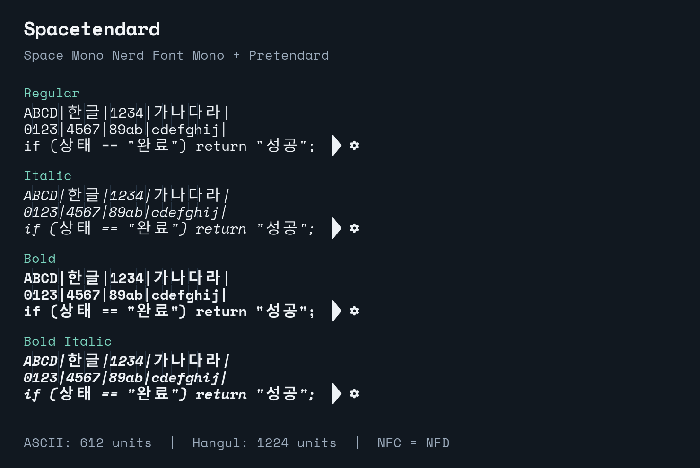
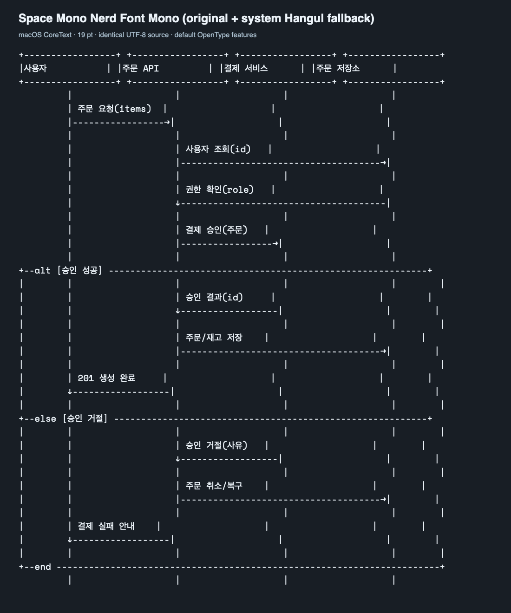
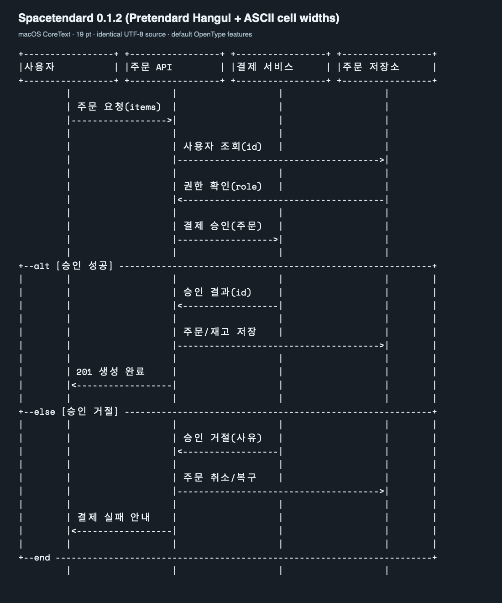

# Spacetendard

[English](README.en.md) · [다운로드](https://github.com/IamGroooooot/spacetendard/releases/latest) · [출처와 감사](NOTICE.md) · [라이선스](LICENSES.md)

**Space Mono Nerd Font Mono + Pretendard. 영문은 1칸, 한글은 2칸.**

[Jetendard](https://github.com/kuskhan/jetendard)에 영감을 받아 같은 방식으로
Spacetendard를 만들었습니다. Jetendard의 빌드 코드를 포크·수정하고,
JetBrains Mono 대신 **Space Mono Nerd Font Mono**에 **Pretendard** 한글을 결합했습니다.

한글이 들어간 ASCII sequence diagram이나 텍스트 UML도 줄이 맞게 보려고 만들었습니다.

```text
 사용자          서버            DB
    |              |              |
    |--- 로그인 -->|              |
    |              |--- 조회 ---->|
    |              |<-- 결과 -----|
    |<-- 성공 -----|              |
    |              |              |
```

한글을 2칸으로 계산하는 에디터·터미널에서 `Spacetendard`를 선택해 보세요.
GitHub 웹페이지의 코드 블록에는 방문자의 글꼴이 적용되므로 이 폰트의 실제 모양은
아래 샘플과 설치한 앱에서 확인할 수 있습니다.



### 한국어 sequence diagram 비교

사용자 조회, 권한 확인, 결제 승인, 성공·거절 분기, 주문 저장·복구를 넣었습니다.
두 이미지 모두 [같은 79칸 원문](assets/diagrams/korean-checkout.txt)을
macOS CoreText에서 19pt, 기본 OpenType 기능으로 렌더링했습니다.
Ghostty 화면 캡처는 아닙니다.

**Space Mono Nerd Font Mono 원본 + macOS의 한글 fallback**



**Spacetendard 0.1.2**



원본에서는 한글 fallback의 폭과 `->`, `<-` 등을 한 칸으로 바꾸는 합자 때문에
일부 줄의 경계가 당겨집니다. Spacetendard는 한글을 영문 2칸에 맞추고,
이 ASCII 합자를 제거해 원문의 칸 수를 유지합니다.
실제 터미널은 자체 셀 배치를 적용하므로 차이는 앱과 설정에 따라 달라질 수 있습니다.
[비교 이미지 재생성 방법](assets/diagrams/README.md)


## 출처와 감사

커스텀할 수 있도록 빌드·병합·폭 맞춤 코드를 공개해주신 **Jetendard** 제작자분들께
감사합니다. Spacetendard는 이 코드를 포크해서 수정한 프로젝트입니다.

영문 서체를 만든 **Space Mono**, 개발용 아이콘을 붙여 배포한 **Nerd Fonts**,
한글 서체를 공개한 **Pretendard** 제작자분들께도 감사합니다.

| 프로젝트 | Spacetendard에서 사용하는 부분 | 원본 |
| --- | --- | --- |
| Jetendard · kuskhan / Jung Woong Park | 빌드 코드, 폰트 병합과 한글 폭 맞춤의 기반 | [저장소](https://github.com/kuskhan/jetendard) |
| Space Mono · Google / Colophon Foundry | 영문 서체 | [저장소](https://github.com/googlefonts/spacemono) |
| Space Mono Nerd Font Mono · Nerd Fonts | 영문 베이스와 개발용 아이콘 | [SpaceMono 폴더](https://github.com/ryanoasis/nerd-fonts/tree/v3.4.0/patched-fonts/SpaceMono) · [릴리스](https://github.com/ryanoasis/nerd-fonts/releases/tag/v3.4.0) |
| Pretendard · 길형진 / Kil Hyung-jin | 한글 글리프 | [저장소](https://github.com/orioncactus/pretendard) · [사용 버전](https://github.com/orioncactus/pretendard/releases/tag/v1.3.9) |

Jetendard가 기반으로 삼은 [Yeomil Mono](https://github.com/taevel02/yeomil-mono)와
각 Nerd Font 아이콘의 제작자분들께도 감사드립니다.
전체 출처·수정 내역은 [NOTICE.md](NOTICE.md)에 남겼습니다.

## 1. 다운로드

일반 설치에는 **TTF**를 받으면 됩니다. 소스 코드 ZIP만으로는 설치할 수 없습니다.

| 파일 | 용도 | 다운로드 |
| --- | --- | --- |
| `Spacetendard-0.1.2-ttf.zip` | macOS·Linux·Windows에 설치 | [TTF 받기](https://github.com/IamGroooooot/spacetendard/releases/download/v0.1.2/Spacetendard-0.1.2-ttf.zip) |
| `Spacetendard-0.1.2-webfont.zip` | 웹사이트에서 CSS·WOFF2 사용 | [웹폰트 받기](https://github.com/IamGroooooot/spacetendard/releases/download/v0.1.2/Spacetendard-0.1.2-webfont.zip) |
| `Spacetendard-0.1.2-otf.zip` | OTF 확장자가 필요한 환경 | [OTF 받기](https://github.com/IamGroooooot/spacetendard/releases/download/v0.1.2/Spacetendard-0.1.2-otf.zip) |

[최신 릴리스와 전체 파일](https://github.com/IamGroooooot/spacetendard/releases/latest)
에서 변경 사항과 체크섬도 확인할 수 있습니다. OTF 파일도 TrueType 윤곽을 사용합니다.

macOS·Linux에서는 빈 작업 폴더에서 다음 명령을 실행하세요.

```sh
mkdir -p spacetendard-download
cd spacetendard-download
VERSION=0.1.2
BASE_URL="https://github.com/IamGroooooot/spacetendard/releases/download/v${VERSION}"
curl -fLO "$BASE_URL/Spacetendard-${VERSION}-ttf.zip"
curl -fLO "$BASE_URL/SHA256SUMS.txt"
unzip "Spacetendard-${VERSION}-ttf.zip"
```

체크섬 파일에서 TTF ZIP의 SHA-256과 다음 명령의 결과를 비교할 수 있습니다.

```sh
# macOS
shasum -a 256 "Spacetendard-${VERSION}-ttf.zip"

# Linux
sha256sum "Spacetendard-${VERSION}-ttf.zip"
```

## 2. 설치

위에서 압축을 푼 `spacetendard-download` 폴더에서 실행합니다.
Regular·Italic·Bold·BoldItalic 네 가지를 함께 설치하세요.

### macOS

현재 사용자에게 설치합니다.

```sh
mkdir -p "$HOME/Library/Fonts/Spacetendard"
cp Spacetendard/*.ttf "$HOME/Library/Fonts/Spacetendard/"
```

### Linux

현재 사용자에게 설치하고 fontconfig 캐시를 갱신합니다.

```sh
mkdir -p "$HOME/.local/share/fonts/Spacetendard"
cp Spacetendard/*.ttf "$HOME/.local/share/fonts/Spacetendard/"
fc-cache -f "$HOME/.local/share/fonts/Spacetendard"
fc-match Spacetendard
```

### Windows — PowerShell

```powershell
$version = '0.1.2'
$url = "https://github.com/IamGroooooot/spacetendard/releases/download/v$version/Spacetendard-$version-ttf.zip"
Invoke-WebRequest -Uri $url -OutFile "Spacetendard-$version-ttf.zip"
Expand-Archive -Path "Spacetendard-$version-ttf.zip" -DestinationPath 'spacetendard-download'
explorer.exe '.\spacetendard-download\Spacetendard'
```

열린 폴더에서 `.ttf` 파일 4개를 선택하고 우클릭하여 **설치**하세요.

## 3. 에디터·터미널에서 선택

설치한 뒤 앱을 다시 열고 글꼴 이름을 **`Spacetendard`**로 지정하세요.

### VS Code

`Preferences: Open User Settings (JSON)`을 열고 기존 설정에 다음 항목을 추가합니다.

```jsonc
{
  "editor.fontFamily": "'Spacetendard', monospace",
  "terminal.integrated.fontFamily": "Spacetendard"
}
```

[VS Code 터미널 글꼴 설정](https://code.visualstudio.com/docs/terminal/appearance)

### Ghostty

Ghostty 설정 파일의 글꼴 항목을 지정합니다.

```ini
font-family = Spacetendard
```

CLI가 PATH에 있으면 설치된 글꼴을 확인할 수 있습니다.

```sh
ghostty +list-fonts
```

[Ghostty 공식 글꼴 설정](https://ghostty.org/docs/config/reference#font-family)

### 웹사이트

웹폰트 ZIP을 풀어 `Spacetendard` 폴더 전체를 사이트의 `/fonts/Spacetendard/`에
복사하고, CSS를 불러옵니다. `licenses` 폴더와 고지 문서도 함께 배포하세요.

```html
<link rel="stylesheet" href="/fonts/Spacetendard/spacetendard.css">
<style>
  pre, code { font-family: 'Spacetendard', monospace; }
</style>
```

## 4. 직접 빌드하고 커스텀하기

[uv 설치 안내](https://docs.astral.sh/uv/getting-started/installation/)를 따라
`uv`를 먼저 준비하세요. Python 3.12 이상을 사용합니다.

```sh
git clone https://github.com/IamGroooooot/spacetendard.git
cd spacetendard
uv sync --locked --all-groups
make download
make run
```

기본 빌드 결과는 다음 경로에 생성됩니다. 원본 다운로드와 이 기본 출력 경로는 Git에서 제외됩니다.

```text
fonts/ttf/Spacetendard-*.ttf
fonts/otf/Spacetendard-*.otf
fonts/webfont/Spacetendard-*.woff2
fonts/webfont/spacetendard.css
```

한글 윤곽의 기본 배율은 `1.15`입니다. 배율을 바꾸어도 셀의 폭은 유지되며,
넘치는 글리프는 셀 안에 들어가도록 크기를 제한합니다.
커스텀 결과를 별도 폴더에 저장하면 기본 결과와 비교하기 편합니다.

```sh
# 전체 옵션
uv run spacetendard --help

# Regular와 Bold만 빌드
uv run spacetendard --variants Regular Bold

# 한글 크기를 조금 줄여 별도로 빌드
uv run spacetendard --korean-scale 1.10 --output-dir fonts/custom

# 이름까지 바꾸어 빌드 — 예시 이름은 원하는 고유 이름으로 바꾸세요
uv run spacetendard --family-name "My Hangul Mono" --output-dir fonts/custom-named

# Regular/Bold × normal/italic 네 스타일
uv run spacetendard --weights Regular Bold --styles normal italic

# 코드 검사와 전체 통합 테스트
make lint
SPACETENDARD_RUN_FULL_INTEGRATION=1 uv run pytest
```

기존 셀 폭 정책은 `src/spacetendard/builder.py`, 옵션과 출력은
`src/spacetendard/cli.py`, 원본 버전과 SHA-256은 `download_upstream.py`에서
확인할 수 있습니다. 다른 원본 폰트를 쓰면 해당 폰트의 라이선스도 별도로 확인하세요.
파생본은 고유한 이름을 쓰고 기존 고지와 자신의 수정 내역을 함께 보존하세요.

## 지원 범위

| 문자·스타일 | 처리 |
| --- | --- |
| ASCII·영문·숫자 | 1칸: 612 units |
| 현대 한글 완성형 11,172자 | 2칸: 1,224 units |
| 현대 한글 분해 자모 NFD | HarfBuzz 같은 조판 엔진에서 NFC와 같은 글리프·폭으로 조합 |
| 호환 자모·지원하는 전각 문자 | 2칸 |
| 지원하는 반각 문자·반각 한글 | 1칸 |
| 스타일 | Regular, Italic, Bold, BoldItalic. Italic에서도 한글은 정체 유지 |

Nerd Fonts **v3.4.0 / SpaceMono.zip**과 Pretendard **v1.3.9**를 고정하고
SHA-256을 검사합니다. 생성한 네 TTF에서 현대 한글 전체와 NFD 전체를 검사하며,
혼합 문자열·반각·전각·아이콘·이름·스타일·고지도 검증합니다.

모든 유니코드나 모든 앱의 정렬을 보장하지는 않습니다. 지원하지 않는 문자,
이모지, 옛한글, 대체 폰트, 터미널의 `wcwidth`·모호한 폭 설정, 조판 엔진에 따라
차이가 날 수 있습니다. Space Mono의 영문·OpenType 기능·Nerd Font 아이콘을
유지하되, ASCII 두 칸을 한 칸으로 줄이는 기본 화살표 합자는 제거합니다.
`->`, `<-`, `|>` 등을 입력한 그대로 표시해 뒤쪽 테두리의 위치를 보존합니다.
실제 유니코드 화살표 `→`·`←`는 1칸 글리프로 유지합니다.
JetBrains Mono의 프로그래밍 합자 세트는 추가하지 않습니다.

## 라이선스와 재배포

Spacetendard의 폰트와 파생 빌드 소프트웨어는 **SIL Open Font License 1.1**로
배포합니다. Nerd Fonts 아이콘 등 외부 구성요소의 원래 고지와 조건도 보존합니다.

- 사용·설치·임베딩·수정·재배포는 해당 조건에 따라 가능합니다.
- 폰트나 파생 폰트를 재배포할 때 원래 저작권, `LICENSE`, `licenses` 폴더와
  출처·수정 고지를 함께 보존하세요. 파생 폰트는 OFL 1.1을 유지해야 합니다.
- `Jetendard`, `Pretendard`, `Yeomil Mono`는 원본의 Reserved Font Name입니다.
  별도 허락 없이 파생 폰트의 이름으로 사용하지 마세요.
- OFL 폰트 자체만을 단독 판매할 수는 없습니다. 폰트로 만든 문서·이미지·다이어그램에
  폰트 라이선스가 전파되지는 않습니다.
- 제작자나 원본 프로젝트의 보증·후원을 주장하지 않으며, 로고·상표 사용 권한을
  부여하지 않습니다. 보증과 책임의 범위는 원문 라이선스를 따릅니다.

[LICENSE](LICENSE)는 적용 라이선스, [NOTICE.md](NOTICE.md)는 출처·감사·수정 내역,
[LICENSES.md](LICENSES.md)는 원본별 조건과 재배포 안내입니다.
원문 라이선스는 [src/spacetendard/licenses](src/spacetendard/licenses)에 있습니다.
